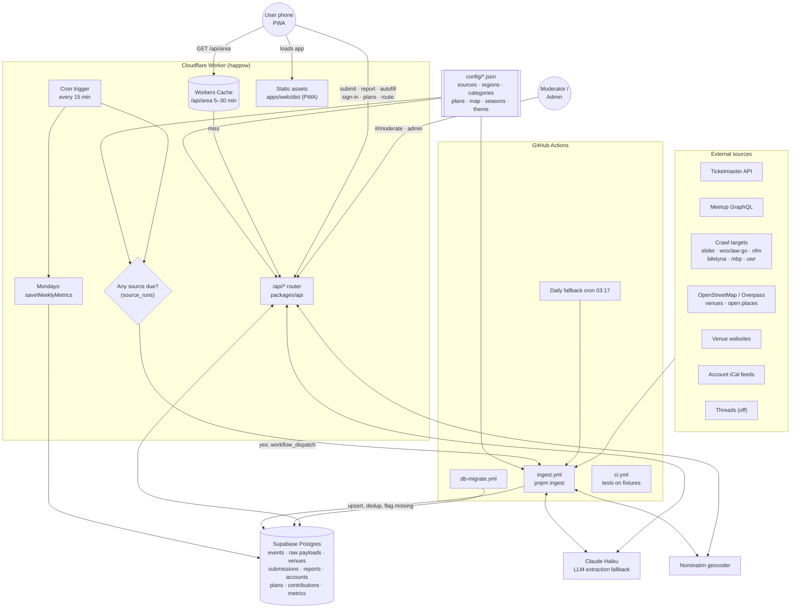
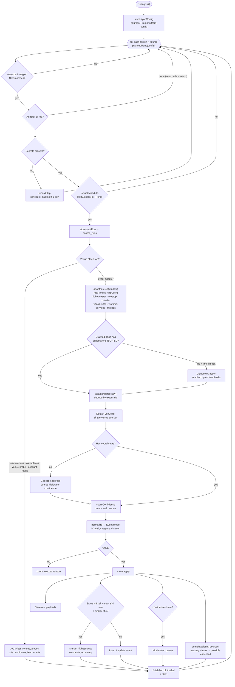
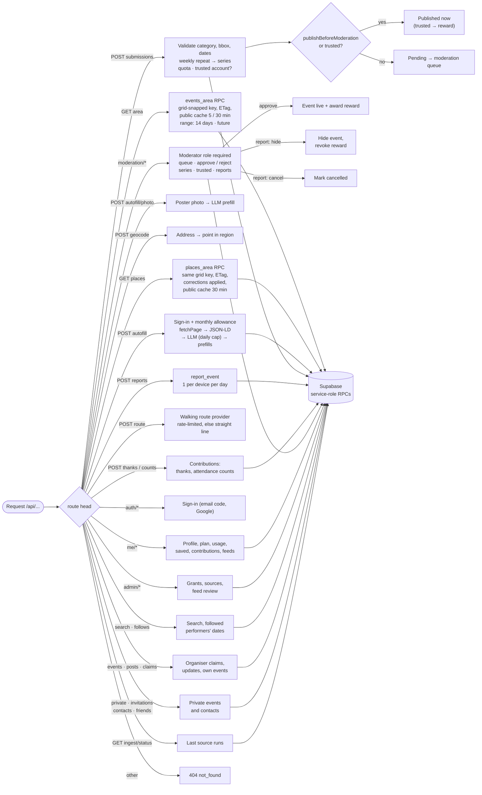
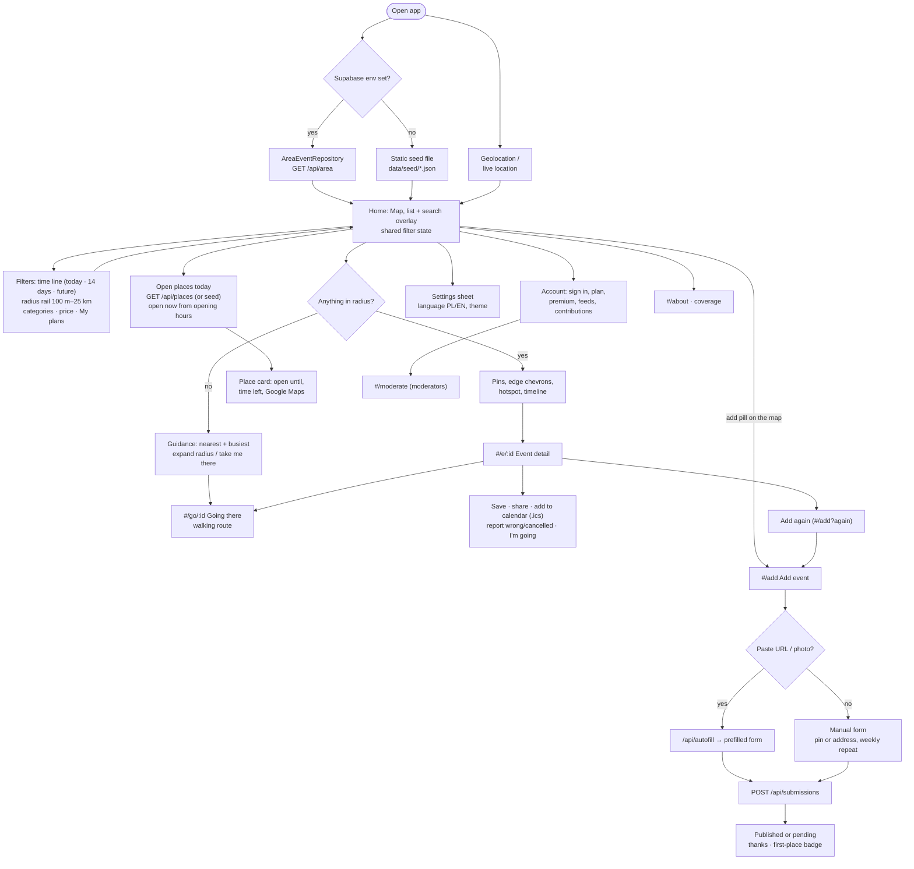

# Happow — architecture

Four Mermaid charts of the whole app. GitHub renders them; keep them in step with the code.

## Happow — whole system overview

Where everything runs and how data moves: config drives the Worker cron, the GitHub ingest job and the API; Supabase sits in the middle.

## Ingestion pipeline (pnpm ingest)

What `pnpm ingest` does for each source (packages/ingest/src/run.ts).

## API request routing (/api/*)

How the Worker routes /api/* (packages/api/src/handler.ts), including submission → moderation → reward.

## PWA user journey (apps/web)

What a person can do in the PWA (apps/web/src/App.tsx, hash routes in useHashRoute.ts).

