# Happening Now — PoC Build Brief

Oct 20, 2026 · @Priam

## Summary and PoC scope

Happening Now is a map-first PWA showing every event happening near the user now, within hours or today, at a default 500 m radius. The PoC runs in one local area (Wrocław) but every source, region and provider is a pluggable config, so scaling means adding adapters, not rewriting code.

Decisions taken (2026-10-20):

| Decision | Choice |
| --- | --- |
| Platform | PWA, built feature-complete first. A native rewrite (Play Store and App Store, home-screen widgets) is the last milestone, unnumbered. After it, a new project maintains and improves the native app (owner, 2026-10-24) |
| Repo | Public GitHub repo; keys only in GitHub Secrets and env files, never committed |
| Build model | Opus 5.5 for planning and UI/UX quality passes; Sonnet 5.5 for routine implementation |
| Geography | Local PoC (Wrocław), architecture region-agnostic from day one |
| Data | Official APIs, web/social crawler and user submissions, all from the start |
| Business model | Free; no monetization in the PoC; later only event add-ons and user features, never paid visibility |
| Weather | Not in the PoC (decided 2026-10-20); kept as a future feature, see Future features |

Why PWA is enough for the PoC: map, geolocation, list, filters, offline cache and install-to-home-screen all work on the web. Limits to accept: no background geofencing, and iOS web push only for installed home-screen apps. Neither blocks validating the core loop (open → see what is on near me → go).

## Competitive landscape

The closest product, Ongeo, validates the AI-crawled "here and now" map but runs only in US beta cities; no European product combines a hyper-local radius, a strict now-window, informal events and density guidance.

| Product | Market | What it does | Gap vs Happening Now |
| --- | --- | --- | --- |
| [Ongeo](https://apps.apple.com/us/app/ongeo/id6755797984) | US beta cities, iOS | Real-time map, opens on "Here+Now", AI crawler over thousands of sources, no login | No Europe, no Android/web |
| [Coigdzie.pl](https://apps.apple.com/pl/app/coigdzie-pl-koncerty-imprezy/id996900077?l=pl) | Poland | Nationwide listings, nearby mode, map navigation; integrated Eventim, eBilet, Going | City-level listings, ticketed focus, no informal events |
| [Evencik](https://apps.apple.com/us/app/id6463662492) | Wrocław | Curated events and promos | Curated, single city, no hyper-local radius |
| [DropIn](https://apps.apple.com/app/id1132386926) | US | Live map of local events, user-created events | Small, little traction |
| Facebook Events / Local | Global | Nearby events map | Discontinued twice after interest faded ([tabletowo](https://www.tabletowo.pl/local-to-nowe-facebook-events)) |

Differentiators to protect: 500 m default radius with density guidance, "now / next hours / today" as the primary axis, and informal categories (garage sales, happenings).

## Core features

The PoC ships one loop: open the app, see what is on within 500 m now, and be guided toward the nearest activity when the circle is empty.

**Map and list**

- Map view by default, list toggle sorted by distance then start time; both share the same filter state.
- Time window chips: Now (running), Next 2 h, Next 6 h, Today. "Now" means start ≤ now ≤ end; events without an end get a category default duration.
- Radius slider 100 m to 25 km, default 500 m, remembered per device.
- Category filters: music, theatre, cinema, exhibition, festival, happening, sport, market and fair, garage sale, kids and family, food, talk and workshop, religious and ceremonies (added 2026-10-21), other. Multi-select; taxonomy is data, not code.
- Price filter: free / paid / any.

**Off-screen direction hints (GTA/Witcher-style)**

- Edge-of-screen chevrons for clusters outside the current viewport, each showing direction, distance and event count ("↗ 1.2 km · 7 events").
- A "hotspot" marker for the densest area within 5 km in the active time window, computed server-side with H3 hexagon counts.
- Empty-radius state never shows a blank map: "Nothing within 500 m. Nearest: 650 m north. Busiest: Rynek, 1.4 km, 12 events." with one-tap "expand radius" or "take me there".
- Chevrons fade with distance and are capped at 6 to keep the map readable.

**Event details**

- Title, category, start and end, venue and address, distance and walking time, price or "free", rules (age limit, dress code, pets, accessibility) when the source provides them.
- Official site link and ticket link; source badge (API / crawled / community) and last-verified time.
- Actions: navigate (hands off to the device map app), add to calendar (.ics), share, save, report as wrong or cancelled.

**Add an event**

- Paste a URL → the server fetches it and pre-fills the form from schema.org/Event JSON-LD, falling back to LLM extraction; the user only confirms.
- Manual form: title, category, place (map pin or address), start, end, price, link, photo.
- Submitted events show as "community, unverified" until they pass moderation.

## Data sources and ingestion

Every source is an adapter with one contract — `fetch(region, window) → RawEvent[]` — registered in a config file with its schedule, region list, rate limit and trust level. Adding a city or a source is a config change plus, at most, one adapter.

| Source | Type | Access and limits | Coverage | PoC role |
| --- | --- | --- | --- | --- |
| [Ticketmaster Discovery](https://freeapihub.com/apis/ticketmaster-discovery) | Official API | Free key, 5,000 calls/day, 5 req/s; geoPoint + radius; Poland market supported ([SDK](https://code.ticketmaster.com/Android-Ignite-Retail-SDK/docs/discoveryAPI/-ticketmaster%20-discovery%20-a-p-i/com.ticketmaster.discoveryapi.enums/-t-m-market-domain/index.html)) | Ticketed concerts, sport, theatre | Core |
| [Meetup GraphQL](https://www.rapidevelopers.com/bolt-ai-integrations/meetup) | Official API | OAuth, about 200 req/h | Meetups, talks | Core |
| City portal (wroclaw.pl/go/wydarzenia) | Crawl | No public API found; respect robots.txt, ask for a feed | Official city events | Core; request partnership |
| Venue and ticketing sites (Going, eBilet, Eventim, theatres, clubs) | Crawl | schema.org/Event JSON-LD where published, LLM extraction otherwise | Long tail of venues | Core |
| [Threads keyword search](https://developers.facebook.com/documentation/threads/keyword-search) | Official API | `threads_keyword_search` permission, about 500 queries per 7 days ([ppc.land](https://ppc.land/meta-introduces-new-search-and-analytics-features-to-threads-api-platform/)) | Informal announcements | Social signal |
| Public Facebook event and group pages | Crawl (logged-out) | Higher legal risk; see Legal | Garage sales, local happenings | Phase 2 after legal check |
| [Google Events via SerpApi](https://www.serpapi.com/google-events-api) | Paid aggregator | Per-search pricing; needs precise location ([forum](https://forum.serpapi.com/bugs/p/google-events-api-returns-blank-results-occasionally)) | Broad | Optional gap-filler |
| User submissions | In-app form + URL autofill | Moderation queue | Everything else | Core |

Ruled out: Eventbrite (public search shut off in February 2020; only lookups by event, venue or organisation remain — [GitHub](https://github.com/Automattic/eventbrite-api/issues/83)) and PredictHQ (free plan limited to 2 locations within 2 miles — [pricing](https://www.predicthq.com/pricing)).

**Pipeline**

1. Adapters run on schedules: APIs every 15 to 60 min, crawl targets every 1 to 6 h, social every 30 min within quota.
2. Raw payloads are stored unchanged (for re-parsing), then normalized to the Event model.
3. LLM extraction for unstructured text (social posts, HTML without JSON-LD) returns strict JSON with a confidence score; below threshold → moderation queue.
4. Geocoding of addresses (Nominatim self-hosted or Photon) with a cache.
5. Deduplication: same H3 cell + start within 30 min + title similarity → merge, keeping the highest-trust source as primary.
6. Freshness: each event keeps `last_seen_at`; events missing from two consecutive fetches of their source are flagged "possibly cancelled".

## Architecture and stack

For the PoC everything runs on free tiers: the PWA and its small API on Cloudflare Workers, Postgres + PostGIS on Supabase, and ingestion as scheduled GitHub Actions jobs. Code stays plain TypeScript on standard Postgres, so moving to a VPS later is a deploy change, not a rewrite. Development happens in Claude Code sessions on the GitHub repo; GitHub is where code lives, not where the app runs.

```mermaid
flowchart LR
  subgraph Sources["Sources (config)"]
    A1["Official event APIs<br/>Ticketmaster, Meetup"]
    A2["Crawl targets<br/>venues, city portal"]
    A3["Social APIs<br/>Threads"]
  end
  subgraph Workers["Ingestion workers"]
    W1["Scheduler<br/>GitHub Actions cron"] --> W2["Source adapters<br/>one per source, from config"]
    W2 --> W3["Normalize + extract<br/>schema.org Event, LLM"]
    W3 --> W4["Geocode + dedup<br/>H3 + title match"]
  end
  Sources --> Workers
  W4 --> DB[("Postgres + PostGIS + H3<br/>events, raw payloads")]
  DB -->|geo queries| API["API (Supabase)<br/>events, hotspots, submissions"]
  API -->|JSON over HTTPS| PWA["PWA (React + MapLibre)<br/>map, list, chevrons, add form"]
```

| Layer | PoC choice (free) | Scale-up path |
| --- | --- | --- |
| Client | React + Vite PWA, MapLibre GL, OSM-based tiles, hosted on Cloudflare Workers (static assets) | A native app, rewritten from the finished PWA (last milestone) |
| API | Supabase auto-generated REST + Postgres functions for geo queries (events near point, hotspots); write endpoints (URL autofill, submissions, reports, moderation) as one Cloudflare Worker on the PWA's origin, calling service-role-only Postgres functions (M4: chosen over a Supabase Edge Function so it shares the monorepo's TypeScript and needs no CORS) | Node + Fastify container behind a CDN |
| Workers | GitHub Actions scheduled workflows, one job per adapter group, writing to Supabase. Free plan gives 2,000 min/month on private repos, unlimited on public ([GitHub](https://docs.github.com/en/billing/concepts/product-billing/github-actions)); a 1-min run every 30 min uses about 1,440 min | BullMQ on Redis on a VPS |
| Storage | Supabase Free: 500 MB Postgres, pauses after 1 week without activity ([Supabase](https://supabase.com/pricing)); scheduled ingestion keeps it busy. H3 indexes computed in code (h3-js) and stored as columns | Supabase Pro ($25/mo, 8 GB, no pause) or self-hosted Postgres |
| LLM extraction | Claude Haiku 5.5 behind an `Extractor` interface: $0.10 in / $0.50 out per million tokens, half that via the Batch API ([pricing](https://platform.claude.com/docs/en/about-claude/pricing)) | Same model; volume discounts if needed |
| Geocoding | Nominatim public API, 1 request/s, cached | Self-hosted Photon |
| Monthly cost | About €0, plus cents of LLM usage | VPS from about €5.50/mo (Hetzner CX23 after the June 2026 increase — [privatedevops](https://privatedevops.com/news/hetzner-june-2026-cloud-price-increase-what-to-do)) |

Token discipline for extraction: parse schema.org JSON-LD first and call the LLM only when it is missing; strip pages to plain text before sending; skip pages whose content hash has not changed; run crawl extraction through the Batch API; keep the fixed instructions in a cached prompt. At about 3,000 input and 300 output tokens per page, 1,000 pages cost under $0.50 at standard Haiku 5.5 rates.

Model for building in Claude Code: Opus 5.5 for the architecture plan, UI/UX quality passes and hard debugging; Sonnet 5.5 for routine implementation.

## Data model

The schema follows schema.org/Event so crawled JSON-LD maps almost one-to-one and exports stay standard.

| Entity | Key fields |
| --- | --- |
| Event | id, title, description, category\_ids\[\], start\_at, end\_at (nullable), end\_estimated (bool), timezone, venue\_id or point (PostGIS geography), h3\_r9, price\_min, price\_max, currency, is\_free, rules (age, pets, accessibility, dress), official\_url, ticket\_url, image\_url, status (scheduled / cancelled / postponed), trust (api / crawled / community), confidence 0–1, created\_at, last\_seen\_at |
| EventSource | event\_id, source\_id, external\_id, source\_url, raw\_payload\_ref, fetched\_at |
| Source | id, adapter, region\_ids\[\], schedule, rate\_limit, trust\_level, enabled, terms\_notes |
| Venue | id, name, address, point, h3\_r9, website, accessibility |
| Category | id, slug, labels {pl, en}, default\_duration\_min, icon |
| Region | id, name, polygon, timezone, enabled\_sources\[\] |
| Submission | id, url, form\_payload, extracted\_payload, status (pending / approved / rejected), moderator\_note, submitter\_hash |

Personal data is minimal: no account required to browse; submissions store a salted device hash, not identity. (The future private-events feature adds accounts, contacts and groups; see Future features.)

## Legal and compliance

Prefer official APIs and published structured data; treat social scraping as the highest-risk source and gate it behind a legal check before it goes live.

- **Social scraping.** A US court held in Meta v. Bright Data that Meta's terms do not bar logged-out scraping of public data ([Farella Braun](https://www.fbm.com/post/102kqw7/)), but practitioners note it may be appealed and is not a blanket permission ([Zyte](https://www.zyte.com/blog/california-court-meta-ruling)). It is a US ruling; EU/Polish law and GDPR apply to this app independently. PoC rule: no logged-in scraping, no personal data stored from posts (keep event facts, drop author identity), honour robots.txt.
- **GDPR.** Location is processed on-device or sent coarse (H3 cell), never stored with an identifier. Privacy policy and cookie-free analytics (e.g. Plausible) from day one.
- **Copyright and attribution.** Store facts (title, time, place, price) and link back; do not republish full descriptions or images from crawled pages without permission. Show the required attribution for map tiles (OpenStreetMap).
- **API terms.** Ticketmaster, Meetup and Meta APIs have display and caching rules; the adapter config stores a `terms_notes` field and a max cache age per source.
- **User submissions.** Terms of use, report button, moderation queue, and takedown contact (DSA-style notice and action).

## Monetization (later, not in the PoC)

Every event is shown equally: no paid placement, no paid ranking, no ads in the map. The PoC has no monetization; these are directions for later.

- **Event add-ons:** optional extras an organizer can attach to their event card (timetable or lineup, live updates, photo gallery, ticket link). They enrich the card but never change its visibility or order.
- **User features (optional supporter tier):** saved searches with alerts, weekend planner, a walking route through several events, offline city pack, home-screen widgets. Map, filters and details stay free.
- **Ticket affiliate links:** commission from ticket platforms, same price for the user, disclosed on the card.

Ruled out: featured or sponsored pins, paid ranking, banner ads, selling location data.

## Milestones and build-agent instructions

Build in increments, each deployable and demoable on a phone in Wrocław. Build order: 1–6 and 8 (done), 12, 9, 10, 11, 7, 13, then the native app. M7 keeps its number but comes after M11 (owner, 2026-10-24). M12 moved up to come right after M8 (owner, 2026-10-26): more events on the map, and people adding them in the app, matter most now. Changed by the owner on 2026-10-24: the PWA is built feature-complete, so the native rewrite can focus on rewriting, with no feature discussions. Every feature below is decided; the native milestone comes last and has no number.

- **M1 Skeleton.** Monorepo, PWA shell, MapLibre map with OSM tiles, geolocation, radius slider, list toggle, Postgres + PostGIS + H3, seed data for 20 hand-entered Wrocław events.
- **M2 Official APIs.** Ticketmaster and Meetup adapters, normalizer, dedup, scheduler, time-window and category filters, event detail screen.
- **M3 Density.** H3 hotspot computation; off-screen chevrons and empty-radius guidance.
- **M4 Crawler and submissions.** JSON-LD crawler with a target list in config, LLM extraction fallback, URL-autofill submission form, moderation screen.
- **M5 Social signals.** Threads keyword adapter (after app review), confidence scoring, "possibly cancelled" logic, analytics. Instagram was dropped from the PoC on 2026-10-21 (see Future features → More venue and event data).
- **M6 Design system and map UX** (added 2026-10-22). Spec: [docs/milestones/M6-design.md](milestones/M6-design.md). Where it differs from Core features above (time chips, radius slider, map/list toggle, pin colours, chevrons), the spec wins. Advantages it delivers: [docs/ADVANTAGES.md](ADVANTAGES.md).
- **M8 Accounts and premium** (added 2026-10-24; next after M6). User accounts (Supabase Auth), the tiers and presets of M6 §8, a premium entitlement behind a provider interface, end-to-end-encrypted atlas sync (M6 §8), and URL autofill with a monthly quota per account (Future features → URL autofill). Also a design change from the owner (2026-10-24): the dashed reach circle goes; the lit veil (M6 §6) shows the reach clearly without it.
- **M9 Sharing and attendance** (added 2026-10-24). Spec: [docs/milestones/M9-sharing-attendance.md](milestones/M9-sharing-attendance.md). Clean `/e/<id>` links with previews, the generated preview image, share as image, QR code, links that outlive the event, "I'm going" and link-scoped counts (Future features → Event links, sharing and attendance), and co-presence (M6 §9).
- **M10 Plan ahead** (added 2026-10-24). Saved and accepted events in one agenda, the evening queue with walking times and overlap warnings, and reminders before a start (Future features → Plan ahead).
- **M11 Organisers and private events** (added 2026-10-24). Organiser accounts and event claims, organiser updates on the event page, organiser self-service publishing, and private events with contacts, groups and invitations, and the friends' view of who's going (M9 §6) (Future features → Organiser updates, Private events, More venue and event data).
- **M12 More events** (added 2026-10-24 as "More venue and event data"; widened and moved up to come right after M8 by the owner on 2026-10-26). Scope: [docs/milestones/M12-more-events.md](milestones/M12-more-events.md). Two halves:
  - **More sources:** venue calendar feeds (iCal / RSS), OpenStreetMap venues (Overpass) with a source review list, regular services at places of worship, cultural institutions and universities, more ticket sites, and an admin coverage view (Future features → More venue and event data).
  - **More people adding events:** faster adding (share into Happow, a poster photo, quick add, add again, recurring events, feed import) and reasons to add, without streaks or guilt mechanics (your impact, premium days for verified events, trusted contributor, places first on the lit map).
- **M7 Search and followed artists** (added 2026-10-22; moved after M12 by the owner on 2026-10-24, as the hyper-local features come first). Spec: [docs/milestones/M7-search-follow.md](milestones/M7-search-follow.md). Performer data, typo-tolerant search, follows on the device, nationwide Ticketmaster matches, and, on M8's accounts, follows sync and new-date alerts (M7 §5).
- **M13 Launch readiness** (added 2026-10-24). Legal texts in the app (terms, privacy policy, art. 14 notice, takedown, storage note), crawler politeness (conditional requests, TDM reservations, contact in the User-Agent), GDPR export and deletion across every account feature, the final domain and contact address in config (Before public launch), and the open items in [docs/HARDENING.md](HARDENING.md) (security and optimization tasks kept during development).
- **Native app** (last, no number). Rewrite the finished PWA as native apps for the Play Store and the App Store (owner, 2026-10-24), with home-screen widgets and native push. The PWA and its specs are the reference; the server, database and API stay. Client speed (M6 §11, §10) is measured here, not on the web build. After this milestone a new project takes over the native app.

Not in the full build: Weather (decided 2026-10-20), Instagram (decided 2026-10-21), Google Places (paid, no caching), Spotify import (M7 §6), ticketing partner feeds (a business agreement, not code). Walking routes at scale is a provider switch in config, done when the quota runs out.

Instructions for the build agent:

- Read this doc first; treat the Decisions table as fixed.
- Every source, region, category and provider lives in config; no city names or API keys in code.
- Each adapter gets a contract test against recorded fixtures; no live calls in CI.
- Ship the PWA mobile-first (380 px), Polish and English UI strings from the start.
- Report after each milestone: what was built, what was skipped, open issues.
- No speed testing on the web build (owner, 2026-10-24): the native app replaces the client. Server-side budgets (query time, API calls per day) still apply.

## Future features (not in the PoC)

Update 2026-10-24: these sections are now the source material for milestones 8–12 (see the milestones list). Weather stays out.

### Weather

Dropped from the PoC on 2026-10-20: it adds little to the core loop (open → see what is on near me → go). The research below is kept for when it returns.

Idea: weather at the spot now and at the event's end hour, plus a warning chip when an official alert covers the area. MET Norway would be the primary provider (free, no key, commercial use within fair use), IMGW for official Polish alerts, and Open-Meteo as the upgrade path for 15-minute resolution.

| Provider | Cost | Commercial use | Notes |
| --- | --- | --- | --- |
| [MET Norway Locationforecast](https://jentic.com/apis/api.met.no/met-no.md) | Free, no key | Allowed within fair use | Must send identifying User-Agent and honour cache headers; NLOD + CC BY 4.0 ([overview](https://slightfuture.com/devel/met-norway-api-endpoints)) |
| [IMGW-PIB public data](https://glama.ai/mcp/servers/bartosz-kuc/honest-imgw-mcp/tree) | Free, no key | Public data | Current station readings and active meteo warnings for Poland |
| [Open-Meteo](https://open-meteo.com/?lat=47.586&lon=1.3359) | Free non-commercial; $29/mo for 1M calls commercial ([pricing](https://openmeteo.substack.com/p/api-subscriptions-for-commercial)) | Paid plan only | 15-minutely data for Central Europe; best resolution for "weather at event end" |
| [Pirate Weather](https://pirateweather.net/) | Free 10,000 calls/month; small donation raises the cap | Allowed | Dark Sky-style API; useful fallback |

Cost control: fetch weather per H3 cell (resolution 7, about 5 km²) and cache it for 30 min, not per event. A city-sized PoC then needs a few hundred calls per day, well inside every free tier. Run it as a scheduled job next to ingestion, since MET Norway requires an identifying User-Agent that browsers cannot send; keep the provider behind a `WeatherProvider` interface and show CC BY 4.0 attribution.

### URL autofill: part of accounts (was the "Automation add-on")

Decided 2026-10-21, changed 2026-10-24: pasting a link to fill the add form (schema.org data, Claude Haiku for pages without it) is no longer a separate paid add-on. It comes with accounts, with a monthly quota per plan: 5 fills a month on a free account, 300 on premium (see `docs/milestones/M8-accounts-premium.md` §5). The code is built (M4); the quota and account check are built (M8 slice C), and it is switched on with `submissions.autofill: "account"` once the add form signs people in (M8 slice G).

- **Cost model:** about $0.0005–0.001 per page at Haiku 5.5 rates, so even 300 fills a month cost under $0.30 per premium account. A global daily cap on LLM calls (`extraction.autofillLlmPerDay`) bounds the bill whatever happens.
- **Only useful fills count:** a page with nothing to fill, or one that fails to load, is free.
- **Possible extras:** recurring imports from an organiser's own events page, and bulk add from a calendar feed (iCal).

### Plan ahead: a "Later" window

Requested 2026-10-21. The PoC is about what is on now and today. The full app should also handle events further ahead (update 2026-10-22: the Week and Later windows are part of M6, see `docs/milestones/M6-design.md` §13; the agenda, evening queue and reminders below remain future work):
- **A "Later" time filter** next to Now / 2 h / 6 h / Today, with a date picker for "this weekend" or a chosen evening.
- **Saved and accepted events in one agenda.** This includes invitations to private events once those exist.
- **An evening queue:** several events in a row, with walking times between them and a warning when two overlap or one ends too late to make the next.
- **Reminders** before an event starts (web push from the installed PWA).

What it needs: a time window that is not tied to "now" (the area snapshot already supports configurable hours, `refresh.areaHours`), a "Saved" list (saved events already exist per device), and accounts once agendas should sync across devices.

### More venue and event data

Decided 2026-10-21: Instagram is off for the PoC. These ideas could add venues and events later. Each one would be an adapter plus config, like the current sources.

- **Instagram hashtag search** (dropped from M5). It would read recent posts with hashtags like #wyprzedazgarazowa or #pchlitarg and let Claude Haiku turn the captions into events. It needs an Instagram Business account linked to a Facebook Page, plus Meta App Review. It is limited to 30 hashtags per 7 days. Captions rarely give an exact place and time. It is also personal social content under GDPR, so the yield is low and the legal risk is the highest of any source.
- **OpenStreetMap venues (Overpass).** OSM lists theatres, clubs, cinemas, community centres and places of worship. Each entry has a name, a point, a website and often opening hours and wheelchair access. That would fill in the Venue table, find event pages worth crawling (from each venue's `website` tag), and correct venue pins. The data is open (ODbL, with attribution).
- **Regular services at places of worship.** OSM's `service_times` tag and parish websites give mass and service times. These could become recurring events in the "religious" category, generated from a weekly pattern rather than fetched each day.
- **Venue calendar feeds (iCal / RSS).** Many venue sites publish a calendar feed, for example WordPress sites with The Events Calendar (`?ical=1`). These feeds are structured, cheap to read and low-risk. A feed adapter would take a list of URLs from config.
- **Cultural institutions and universities.** City culture centres, libraries and university calendars. They are crawl targets like NFM, ideally with a feed agreement.
- **Ticketing partner feeds** (Going, Eventim). Ask for an affiliate or partner feed instead of crawling.
- **Organiser self-service.** Organisers claim their venue and publish events directly (fits the organiser accounts in "Organiser updates on the event page").
- **Google Places.** Opening hours and popular times. It is paid and its terms forbid caching, so it is the last option.

### Walking routes at scale

The PoC draws in-app routes with openrouteservice's free Standard plan (2,000 routes a day). Most people use the Google Maps button, which costs nothing, so the quota covers a city comfortably. When it doesn't:
- **Hosted alternatives:** Geoapify (3,000 a day free, commercial use allowed) or Mapbox (100,000 a month free, then $2 per 1,000).
- **Self-hosting** an open-source engine on Hetzner: Valhalla for Poland on a CX33/CX43 (€8.49–15.99 a month), all of Europe on 32–64 GB (€29–57 a month).
  - Traffic barely changes the cost: a walking route takes milliseconds of CPU, and a small server answers hundreds a second. The map data in memory sets the size.
  - OSM data is rebuilt weekly or monthly by a scheduled job.
- The routing provider is config (`navigation.routing`), so switching is a small adapter, not a rewrite.

### Organiser updates on the event page

Requested 2026-10-21. The event page gets a small feed of short posts from the event's organiser, for example "Happy hour until 20:00", "Start moved to 19:30", "Entrance from Ruska street only" or "Bring ID, bag checks at the door".

- **Who can post:** a verified organiser of that event. That means organiser accounts plus a way to claim an event, such as a code sent to the email or site in the listing, or moderator approval.
- **Post types:**
  - **Schedule change.** It updates the event's own time or status, so the map, list and calendar stay right.
  - **Safety / important.** Pinned to the top, with a highlighted style.
  - **Promo / info.** Normal posts.
- **Reaching people:** people who saved the event see a badge in the app. Web push notifications come later (on iOS they need the installed PWA).
- **Paid tier:** promos and extra posts are part of the organiser subscription. Schedule changes and safety notices should stay free, because they protect visitors and keep the map accurate.
- **Moderation:** posts can be reported like events, with a length limit and no external images in the PoC.
- **Battery and data:** posts load with the event's detail view, not with the map, so they add no background traffic.

### Event links, sharing and attendance

Requested 2026-10-22. A shared event should open in Happow itself: its card, the in-app walking route and a way to say you're going, not a Google Maps pin. It should also preview properly when pasted into WhatsApp, Messenger, Instagram or X.

- **What exists today.** Share sends an in-app link (`/#/e/<id>`) through the phone's share sheet, or copies it, and the link opens the event card. Two gaps:
  - **Generic previews.** Social apps fetch a link without running JavaScript and never see the part after `#`, so every shared event previews as "Happow", not as its title, time and place.
  - **Maps hand-off still offered.** Navigation offers the Google Maps hand-off next to the in-app route.
- **Clean event URLs: `/e/<id>`.** The `#/e/<id>` form keeps working.
  - The Worker answers `/e/*` first: `"run_worker_first": ["/api/*", "/e/*"]` in `wrangler.jsonc`, a one-line change.
  - It returns the app's HTML with Open Graph and Twitter Card tags for that event: title, start–end, venue, category and canonical URL.
  - The SPA reads the path and opens the event card.
- **Preview image.** Our own generated card, never the source's image (copyright rule): a map snippet with the pin, the time and the category glyph in the app's style, 1200×630. It is rendered in the Worker and cached at the edge per event version.
- **Opening in the app.**
  - Android: an installed PWA (WebAPK) captures links in its scope, so the tap opens the installed app.
  - iOS: Home Screen web apps can't capture links, so the link opens in Safari. The full app works there without installing; show a one-line "Add to Home Screen" hint.
  - Either way, the recipient needs no account and no install.
- **Navigation inside.** The shared card leads with the in-app route ("Going there"). The Google/Apple Maps hand-off becomes a secondary option.
- **Attendance from the link.**
  - **"I'm going"** on the card: anonymous, one per device (salted token, as for submissions). It feeds the going / on-the-way counts in M6 §9, shown from 5 people.
  - **Link-scoped count for the sharer.** Each share carries a token, and the sharer sees "3 people from your link are going", without names. Names appear only when both are logged in and the recipient chooses to show theirs; that is the bridge to private events with invitations below.
  - **"I'm here" ✓** on arrival, as in M6 §9.
  - Attendance is off for religious and political events, as in M6 §9.
- **Sharing beyond links.**
  - The share sheet sends the link plus a short text (title · time · venue).
  - "Share as image" for Instagram Stories and similar apps: the preview card as an image file through the Web Share API, with the link in the text.
  - A QR code on the card, for organisers' posters and flyers.
- **Links that outlive the event.** An ended event's link shows "Ended" plus what's on now near that place, so old shares still lead somewhere live.
- **Private events.** A private event's link opens only for invitees (enforced by row-level security). Everyone else sees "Private event", and the preview tags stay generic, so no details leak.
- **Cost.** One Worker request per link open or preview fetch; preview images are cached at the edge. No new data sources.
- **Tier.** Free for everyone: sharing is the app's growth loop.

### Private events with invitations

Requested 2026-10-20. An organiser can mark an event as **private**: it is visible on the map, in the list and by link only to the people they invited. Everything public keeps working without an account.

- **Accounts.** Login is needed only to create private events or to see ones you were invited to. Browsing public events stays anonymous. Use Supabase Auth (email magic link, optionally Google and Apple), which fits the current stack.
- **Contacts and groups.** Each user keeps a contact list (people they invited or accepted) and can sort contacts into **groups** ("Family", "Running club"), so a whole group can be invited at once. Groups are the minimum contact management.
- **Invitations.** Invite by group, by individual contact, or by a link or email for people without an account yet (they sign up on accepting). Invitees can accept or decline. The organiser can revoke an invitation, and edits or cancellations reach all invitees.
- **Visibility.** Private events never appear in public queries, density counts, hotspots, chevrons or shares. Enforce this in Postgres row-level security (event visible if public, or if the viewer is the owner or an invitee), not in the client.
- **Data model additions.** On events: `visibility` (public / private) and `owner_id`. New tables: users (from Supabase Auth), `contacts` (owner, contact user or email, display name), `groups` and `group_members`, and `invitations` (event, invitee user or email, status pending / accepted / declined / revoked, token for link invites).
- **Privacy.** This adds personal data (emails, contact lists), so GDPR applies directly. It needs consent at sign-up, account and data deletion, data export, minimal retention for unaccepted email invites, and no use of contacts for anything else.
- **Fits the business model.** It is a user feature, so it could later be part of the optional supporter tier. Public events stay free and equal.

## Open questions

- [ ] Contact Wrocław city (ARAW) about an events feed or partnership?
- [ ] Is Facebook public-page crawling in scope at all, after a legal opinion under Polish/EU law?
- [ ] Brand name: search HAPPOW / HAPPO / HAPOW in TMview (EUIPO + UPRP), WIPO Brand DB and IP Australia; consider filing "Happow" (classes 9, 35, 41, 42). happow.com is an Australian youth eLearning company (HAPPOW PTY LTD); a US "HAPPOW" mark exists in class 28 only.
- [ ] Domain and email: register happow.app (Cloudflare Registrar) and happow.pl (Polish registrar), forward a contact address with Cloudflare Email Routing, replace the interim `legal.contactEmail` (the owner's personal address, set 2026-10-22) and the crawler User-Agent URL (`ingest.userAgent`).

## Before public launch (to-do)

- [ ] **Legal texts** (Claude to draft when the app is feature-complete): terms of use, privacy policy (GDPR: hashed device ids, performer/organiser names under legitimate interest, art. 14 notice), takedown procedure, cookie/storage note. Replace the draft bullets on the About page.
- [ ] **Crawl permissions:** email eBilet for written consent or a partner feed (owner decision 2026-10-22: keep crawling its listing page during private testing; consent is needed before launch); email ARAW (wroclaw.pl/go) for consent or a feed; courtesy email to NFM. The crawler policy (`docs/CRAWLER.md`) is published at `/crawler` on the app, which the crawler's User-Agent links to.
- [ ] **Crawler politeness:** conditional requests (ETag / If-Modified-Since), skip unchanged detail pages, respect TDM reservations (`/.well-known/tdmrep.json`, `tdm-reservation` meta) before sending page text to the LLM, add the contact email to the User-Agent.
- [ ] Under the Plumbi umbrella or standalone?
