# Happening Now — PoC Build Brief

Oct 20, 2026 · @Priam

## Summary and PoC scope

Happening Now is a map-first PWA showing every event happening near the user now, within hours or today, at a default 500 m radius. The PoC runs in one local area (Wrocław) but every source, region and provider is a pluggable config, so scaling means adding adapters, not rewriting code.

Decisions taken (2026-10-20):

| Decision | Choice |
| --- | --- |
| Platform | PWA for the PoC; native wrapper later only if background location or store presence is needed |
| Repo | Public GitHub repo; keys only in GitHub Secrets and env files, never committed |
| Build model | Opus 5.5 for planning and UI/UX quality passes; Sonnet 5.5 for routine implementation |
| Geography | Local PoC (Wrocław), architecture region-agnostic from day one |
| Data | Official APIs, web/social crawler and user submissions, all from the start |
| Business model | Free; no monetization in the PoC; later only event add-ons and user features, never paid visibility |
| Weather | Not in the PoC (decided 2026-10-20); kept as a future feature, see Future features |

Why PWA is enough for the PoC: map, geolocation, list, filters, offline cache and install-to-home-screen all work on the web. Limits to accept: no background geofencing, and iOS web push only for installed home-screen apps. Neither blocks validating the core loop (open → see what is on near me → go).

## Competitive landscape

The closest product, Ongeo, validates the AI-crawled "here and now" map but runs only in US beta cities; no European product combines a hyper-local radius, a strict now-window, informal events and density guidance.

| Product | Market | What it does | Gap vs Happening Now |
| --- | --- | --- | --- |
| [Ongeo](https://apps.apple.com/us/app/ongeo/id6755797984) | US beta cities, iOS | Real-time map, opens on "Here+Now", AI crawler over thousands of sources, no login | No Europe, no Android/web |
| [Coigdzie.pl](https://apps.apple.com/pl/app/coigdzie-pl-koncerty-imprezy/id996900077?l=pl) | Poland | Nationwide listings, nearby mode, map navigation; integrated Eventim, eBilet, Going | City-level listings, ticketed focus, no informal events |
| [Evencik](https://apps.apple.com/us/app/id6463662492) | Wrocław | Curated events and promos | Curated, single city, no hyper-local radius |
| [DropIn](https://apps.apple.com/app/id1132386926) | US | Live map of local events, user-created events | Small, little traction |
| Facebook Events / Local | Global | Nearby events map | Discontinued twice after interest faded ([tabletowo](https://www.tabletowo.pl/local-to-nowe-facebook-events)) |

Differentiators to protect: 500 m default radius with density guidance, "now / next hours / today" as the primary axis, and informal categories (garage sales, happenings).

## Core features

The PoC ships one loop: open the app, see what is on within 500 m now, and be guided toward the nearest activity when the circle is empty.

**Map and list**

- Map view by default, list toggle sorted by distance then start time; both share the same filter state.
- Time window chips: Now (running), Next 2 h, Next 6 h, Today. "Now" means start ≤ now ≤ end; events without an end get a category default duration.
- Radius slider 100 m to 25 km, default 500 m, remembered per device.
- Category filters: music, theatre, cinema, exhibition, festival, happening, sport, market and fair, garage sale, kids and family, food, talk and workshop, other. Multi-select; taxonomy is data, not code.
- Price filter: free / paid / any.

**Off-screen direction hints (GTA/Witcher-style)**

- Edge-of-screen chevrons for clusters outside the current viewport, each showing direction, distance and event count ("↗ 1.2 km · 7 events").
- A "hotspot" marker for the densest area within 5 km in the active time window, computed server-side with H3 hexagon counts.
- Empty-radius state never shows a blank map: "Nothing within 500 m. Nearest: 650 m north. Busiest: Rynek, 1.4 km, 12 events." with one-tap "expand radius" or "take me there".
- Chevrons fade with distance and are capped at 6 to keep the map readable.

**Event details**

- Title, category, start and end, venue and address, distance and walking time, price or "free", rules (age limit, dress code, pets, accessibility) when the source provides them.
- Official site link and ticket link; source badge (API / crawled / community) and last-verified time.
- Actions: navigate (hands off to the device map app), add to calendar (.ics), share, save, report as wrong or cancelled.

**Add an event**

- Paste a URL → the server fetches it and pre-fills the form from schema.org/Event JSON-LD, falling back to LLM extraction; the user only confirms.
- Manual form: title, category, place (map pin or address), start, end, price, link, photo.
- Submitted events show as "community, unverified" until they pass moderation.

## Data sources and ingestion

Every source is an adapter with one contract — `fetch(region, window) → RawEvent[]` — registered in a config file with its schedule, region list, rate limit and trust level. Adding a city or a source is a config change plus, at most, one adapter.

| Source | Type | Access and limits | Coverage | PoC role |
| --- | --- | --- | --- | --- |
| [Ticketmaster Discovery](https://freeapihub.com/apis/ticketmaster-discovery) | Official API | Free key, 5,000 calls/day, 5 req/s; geoPoint + radius; Poland market supported ([SDK](https://code.ticketmaster.com/Android-Ignite-Retail-SDK/docs/discoveryAPI/-ticketmaster%20-discovery%20-a-p-i/com.ticketmaster.discoveryapi.enums/-t-m-market-domain/index.html)) | Ticketed concerts, sport, theatre | Core |
| [Meetup GraphQL](https://www.rapidevelopers.com/bolt-ai-integrations/meetup) | Official API | OAuth, about 200 req/h | Meetups, talks | Core |
| City portal (wroclaw.pl/go/wydarzenia) | Crawl | No public API found; respect robots.txt, ask for a feed | Official city events | Core; request partnership |
| Venue and ticketing sites (Going, eBilet, Eventim, theatres, clubs) | Crawl | schema.org/Event JSON-LD where published, LLM extraction otherwise | Long tail of venues | Core |
| [Threads keyword search](https://developers.facebook.com/documentation/threads/keyword-search) | Official API | `threads_keyword_search` permission, about 500 queries per 7 days ([ppc.land](https://ppc.land/meta-introduces-new-search-and-analytics-features-to-threads-api-platform/)) | Informal announcements | Social signal |
| [Instagram hashtag search](https://developers.facebook.com/docs/instagram-platform/instagram-api-with-facebook-login/hashtag-search) | Official API | App Review; 30 unique hashtags per account per 7 days | #wyprzedazgarazowa, #pchlitarg, #wroclaw events | Social signal, narrow |
| Public Facebook event and group pages | Crawl (logged-out) | Higher legal risk; see Legal | Garage sales, local happenings | Phase 2 after legal check |
| [Google Events via SerpApi](https://www.serpapi.com/google-events-api) | Paid aggregator | Per-search pricing; needs precise location ([forum](https://forum.serpapi.com/bugs/p/google-events-api-returns-blank-results-occasionally)) | Broad | Optional gap-filler |
| User submissions | In-app form + URL autofill | Moderation queue | Everything else | Core |

Ruled out: Eventbrite (public search shut off in February 2020; only lookups by event, venue or organisation remain — [GitHub](https://github.com/Automattic/eventbrite-api/issues/83)) and PredictHQ (free plan limited to 2 locations within 2 miles — [pricing](https://www.predicthq.com/pricing)).

**Pipeline**

1. Adapters run on schedules: APIs every 15 to 60 min, crawl targets every 1 to 6 h, social every 30 min within quota.
2. Raw payloads are stored unchanged (for re-parsing), then normalized to the Event model.
3. LLM extraction for unstructured text (social posts, HTML without JSON-LD) returns strict JSON with a confidence score; below threshold → moderation queue.
4. Geocoding of addresses (Nominatim self-hosted or Photon) with a cache.
5. Deduplication: same H3 cell + start within 30 min + title similarity → merge, keeping the highest-trust source as primary.
6. Freshness: each event keeps `last_seen_at`; events missing from two consecutive fetches of their source are flagged "possibly cancelled".

## Architecture and stack

For the PoC everything runs on free tiers: the PWA on Cloudflare Pages, Postgres + PostGIS on Supabase, and ingestion as scheduled GitHub Actions jobs. Code stays plain TypeScript on standard Postgres, so moving to a VPS later is a deploy change, not a rewrite. Development happens in Claude Code sessions on the GitHub repo; GitHub is where code lives, not where the app runs.

```mermaid
flowchart LR
  subgraph Sources["Sources (config)"]
    A1["Official event APIs<br/>Ticketmaster, Meetup"]
    A2["Crawl targets<br/>venues, city portal"]
    A3["Social APIs<br/>Threads, Instagram"]
  end
  subgraph Workers["Ingestion workers"]
    W1["Scheduler<br/>GitHub Actions cron"] --> W2["Source adapters<br/>one per source, from config"]
    W2 --> W3["Normalize + extract<br/>schema.org Event, LLM"]
    W3 --> W4["Geocode + dedup<br/>H3 + title match"]
  end
  Sources --> Workers
  W4 --> DB[("Postgres + PostGIS + H3<br/>events, raw payloads")]
  DB -->|geo queries| API["API (Supabase)<br/>events, hotspots, submissions"]
  API -->|JSON over HTTPS| PWA["PWA (React + MapLibre)<br/>map, list, chevrons, add form"]
```

| Layer | PoC choice (free) | Scale-up path |
| --- | --- | --- |
| Client | React + Vite PWA, MapLibre GL, OSM-based tiles, hosted on Cloudflare Pages | Same, plus a Capacitor wrapper for store apps |
| API | Supabase auto-generated REST + Postgres functions for geo queries (events near point, hotspots); one Edge Function for URL-autofill extraction | Node + Fastify container behind a CDN |
| Workers | GitHub Actions scheduled workflows, one job per adapter group, writing to Supabase. Free plan gives 2,000 min/month on private repos, unlimited on public ([GitHub](https://docs.github.com/en/billing/concepts/product-billing/github-actions)); a 1-min run every 30 min uses about 1,440 min | BullMQ on Redis on a VPS |
| Storage | Supabase Free: 500 MB Postgres, pauses after 1 week without activity ([Supabase](https://supabase.com/pricing)); scheduled ingestion keeps it busy. H3 indexes computed in code (h3-js) and stored as columns | Supabase Pro ($25/mo, 8 GB, no pause) or self-hosted Postgres |
| LLM extraction | Claude Haiku 5.5 behind an `Extractor` interface: $0.10 in / $0.50 out per million tokens, half that via the Batch API ([pricing](https://platform.claude.com/docs/en/about-claude/pricing)) | Same model; volume discounts if needed |
| Geocoding | Nominatim public API, 1 request/s, cached | Self-hosted Photon |
| Monthly cost | About €0, plus cents of LLM usage | VPS from about €5.50/mo (Hetzner CX23 after the June 2026 increase — [privatedevops](https://privatedevops.com/news/hetzner-june-2026-cloud-price-increase-what-to-do)) |

Token discipline for extraction: parse schema.org JSON-LD first and call the LLM only when it is missing; strip pages to plain text before sending; skip pages whose content hash has not changed; run crawl extraction through the Batch API; keep the fixed instructions in a cached prompt. At about 3,000 input and 300 output tokens per page, 1,000 pages cost under $0.50 at standard Haiku 5.5 rates.

Model for building in Claude Code: Opus 5.5 for the architecture plan, UI/UX quality passes and hard debugging; Sonnet 5.5 for routine implementation.

## Data model

The schema follows schema.org/Event so crawled JSON-LD maps almost one-to-one and exports stay standard.

| Entity | Key fields |
| --- | --- |
| Event | id, title, description, category\_ids\[\], start\_at, end\_at (nullable), end\_estimated (bool), timezone, venue\_id or point (PostGIS geography), h3\_r9, price\_min, price\_max, currency, is\_free, rules (age, pets, accessibility, dress), official\_url, ticket\_url, image\_url, status (scheduled / cancelled / postponed), trust (api / crawled / community), confidence 0–1, created\_at, last\_seen\_at |
| EventSource | event\_id, source\_id, external\_id, source\_url, raw\_payload\_ref, fetched\_at |
| Source | id, adapter, region\_ids\[\], schedule, rate\_limit, trust\_level, enabled, terms\_notes |
| Venue | id, name, address, point, h3\_r9, website, accessibility |
| Category | id, slug, labels {pl, en}, default\_duration\_min, icon |
| Region | id, name, polygon, timezone, enabled\_sources\[\] |
| Submission | id, url, form\_payload, extracted\_payload, status (pending / approved / rejected), moderator\_note, submitter\_hash |

Personal data is minimal: no account required to browse; submissions store a salted device hash, not identity.

## Legal and compliance

Prefer official APIs and published structured data; treat social scraping as the highest-risk source and gate it behind a legal check before it goes live.

- **Social scraping.** A US court held in Meta v. Bright Data that Meta's terms do not bar logged-out scraping of public data ([Farella Braun](https://www.fbm.com/post/102kqw7/)), but practitioners note it may be appealed and is not a blanket permission ([Zyte](https://www.zyte.com/blog/california-court-meta-ruling)). It is a US ruling; EU/Polish law and GDPR apply to this app independently. PoC rule: no logged-in scraping, no personal data stored from posts (keep event facts, drop author identity), honour robots.txt.
- **GDPR.** Location is processed on-device or sent coarse (H3 cell), never stored with an identifier. Privacy policy and cookie-free analytics (e.g. Plausible) from day one.
- **Copyright and attribution.** Store facts (title, time, place, price) and link back; do not republish full descriptions or images from crawled pages without permission. Show the required attribution for map tiles (OpenStreetMap).
- **API terms.** Ticketmaster, Meetup and Meta APIs have display and caching rules; the adapter config stores a `terms_notes` field and a max cache age per source.
- **User submissions.** Terms of use, report button, moderation queue, and takedown contact (DSA-style notice and action).

## Monetization (later, not in the PoC)

Every event is shown equally: no paid placement, no paid ranking, no ads in the map. The PoC has no monetization; these are directions for later.

- **Event add-ons:** optional extras an organizer can attach to their event card (timetable or lineup, live updates, photo gallery, ticket link). They enrich the card but never change its visibility or order.
- **User features (optional supporter tier):** saved searches with alerts, weekend planner, a walking route through several events, offline city pack, home-screen widgets. Map, filters and details stay free.
- **Ticket affiliate links:** commission from ticket platforms, same price for the user, disclosed on the card.

Ruled out: featured or sponsored pins, paid ranking, banner ads, selling location data.

## Milestones and build-agent instructions

Build in five increments, each deployable and demoable on a phone in Wrocław.

1. **Skeleton.** Monorepo, PWA shell, MapLibre map with OSM tiles, geolocation, radius slider, list toggle, Postgres + PostGIS + H3, seed data for 20 hand-entered Wrocław events.
2. **Official APIs.** Ticketmaster and Meetup adapters, normalizer, dedup, scheduler, time-window and category filters, event detail screen.
3. **Density.** H3 hotspot computation; off-screen chevrons and empty-radius guidance.
4. **Crawler and submissions.** JSON-LD crawler with a target list in config, LLM extraction fallback, URL-autofill submission form, moderation screen.
5. **Social signals.** Threads keyword and Instagram hashtag adapters (after app review), confidence scoring, "possibly cancelled" logic, analytics.

Instructions for the build agent:

- Read this doc first; treat the Decisions table as fixed.
- Every source, region, category and provider lives in config; no city names or API keys in code.
- Each adapter gets a contract test against recorded fixtures; no live calls in CI.
- Ship the PWA mobile-first (380 px), Polish and English UI strings from the start.
- Report after each milestone: what was built, what was skipped, open issues.

## Future features (not in the PoC)

### Weather

Dropped from the PoC on 2026-10-20: it adds little to the core loop (open → see what is on near me → go). The research below is kept for when it returns.

Idea: weather at the spot now and at the event's end hour, plus a warning chip when an official alert covers the area. MET Norway would be the primary provider (free, no key, commercial use within fair use), IMGW for official Polish alerts, and Open-Meteo as the upgrade path for 15-minute resolution.

| Provider | Cost | Commercial use | Notes |
| --- | --- | --- | --- |
| [MET Norway Locationforecast](https://jentic.com/apis/api.met.no/met-no.md) | Free, no key | Allowed within fair use | Must send identifying User-Agent and honour cache headers; NLOD + CC BY 4.0 ([overview](https://slightfuture.com/devel/met-norway-api-endpoints)) |
| [IMGW-PIB public data](https://glama.ai/mcp/servers/bartosz-kuc/honest-imgw-mcp/tree) | Free, no key | Public data | Current station readings and active meteo warnings for Poland |
| [Open-Meteo](https://open-meteo.com/?lat=47.586&lon=1.3359) | Free non-commercial; $29/mo for 1M calls commercial ([pricing](https://openmeteo.substack.com/p/api-subscriptions-for-commercial)) | Paid plan only | 15-minutely data for Central Europe; best resolution for "weather at event end" |
| [Pirate Weather](https://pirateweather.net/) | Free 10,000 calls/month; small donation raises the cap | Allowed | Dark Sky-style API; useful fallback |

Cost control: fetch weather per H3 cell (resolution 7, about 5 km²) and cache it for 30 min, not per event. A city-sized PoC then needs a few hundred calls per day, well inside every free tier. Run it as a scheduled job next to ingestion, since MET Norway requires an identifying User-Agent that browsers cannot send; keep the provider behind a `WeatherProvider` interface and show CC BY 4.0 attribution.

## Open questions

- [ ] Contact Wrocław city (ARAW) about an events feed or partnership?
- [ ] Which Instagram Business account will run the hashtag adapter, and which 30 hashtags?
- [ ] Is Facebook public-page crawling in scope at all, after a legal opinion under Polish/EU law?
- [ ] Brand name check: "Happening Now" domain and store-name availability.
- [ ] Under the Plumbi umbrella or standalone?
